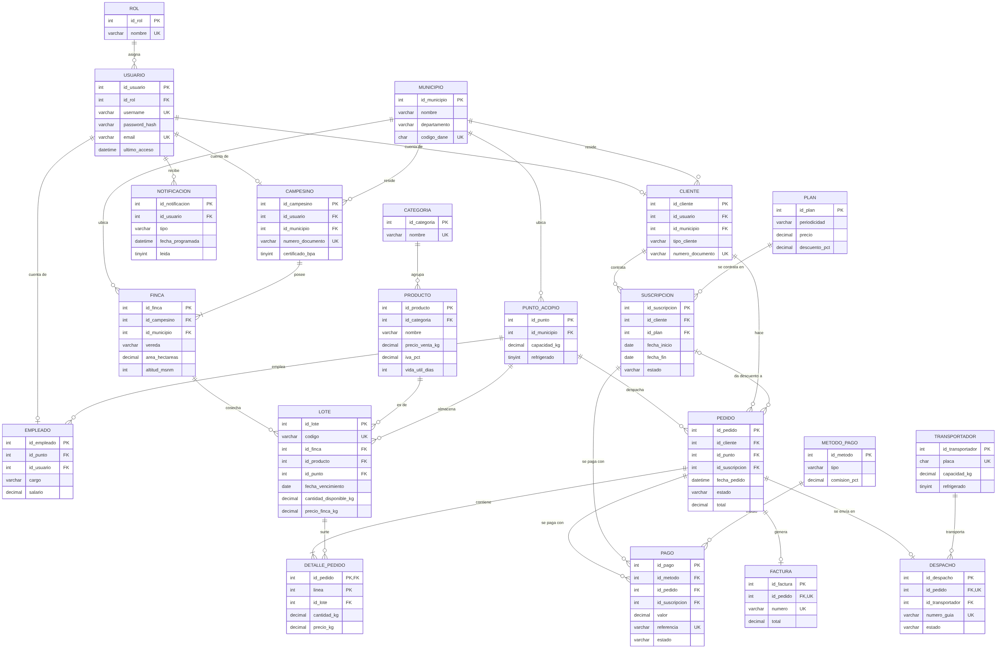

# FrutiMarket BD · Proyecto final de Bases de Datos

Sistema de información web para la **comercialización de frutas y productos campesinos del Quindío**, construido
sobre el dominio del proyecto [FrutiMarket](https://github.com/HKH-Dev/FrutiMarket) (Programación Avanzada) y
adaptado al caso de estudio de la asignatura de Bases de Datos (Universidad del Quindío, 2026-2).

- **Motor:** MariaDB 10.6+ (compatible con MySQL 8). Todo el acceso a datos es SQL escrito a mano (JdbcTemplate), sin ORM.
- **Aplicación:** web, Java 21 + Spring Boot 4.1 + Thymeleaf + Bootstrap 5.
- **PDF:** plantillas HTML convertidas con openhtmltopdf; gráficos con Chart.js (web) y JFreeChart (PDF).



## Cómo se adaptó el caso de estudio

El caso de ejemplo (turismo y hotelería) conecta a **consumidores**, **prestadores de servicios** e **intermediarios**
y pide tres características mínimas. En FrutiMarket los mismos papeles y características quedan así:

| Caso de estudio | En FrutiMarket |
|---|---|
| Viajeros / huéspedes | **Clientes**: hogares, restaurantes, **hoteles** y glampings de la zona turística (Salento, Filandia), tiendas y supermercados |
| Prestadores de servicios | **Campesinos** con sus **fincas**, **transportadores** |
| Intermediarios / plataforma | FrutiMarket con sus **puntos de acopio** y **empleados** |
| Registro y perfil de usuario | Registro público de clientes (`/registro`), perfil editable y cambio de contraseña (`/perfil`) |
| Recordatorios y notificaciones | Tabla `notificacion`: avisos automáticos de pedido, pago, suscripción e inventario, y **recordatorios personales programados** (`/notificaciones`) |
| Planes y pago en línea | **Planes de suscripción** (canastas semanal, quincenal, mensual, restaurante, hotel) y **7 medios de pago** (tarjeta, PSE, Nequi, Daviplata…) con pasarela simulada |

## Cumplimiento de los requisitos

| Requisito | Dónde se cumple |
|---|---|
| Lenguaje y BD (MySQL / SQL Server / Oracle) | Java + MariaDB (fork de MySQL); scripts en `database/` |
| Mínimo 10 entidades fuertes | **20 entidades fuertes** + 1 débil (`detalle_pedido`). Ver [Entidades](#entidades) |
| Registro, modificación, eliminación y consulta | Las 20 entidades tienen CRUD completo en el menú lateral (`/crud/...`) con búsqueda, orden y paginación; los errores de llaves foráneas, únicos y CHECK se traducen a mensajes claros |
| Consultas (datos puntuales) | 8 consultas en `/consultas`, separadas de los reportes |
| 10 reportes (3 simples, 4 intermedios, 3 complejos) | `/reportes`; cada uno se ve en la app, muestra su SQL y se exporta a PDF |
| Bonificación: 3 reportes con gráficos | **5 reportes** con gráfico (4, 5, 7, 8 y 10), también dentro del PDF |
| Login con usuario y contraseña validados | Spring Security, contraseñas BCrypt en la tabla `usuario`, roles ADMIN / OPERADOR / CAMPESINO / CLIENTE |
| Plantillas de documentos | Factura de venta, comprobante de pago, guía de despacho y certificado de suscripción (`templates/pdf/`) |
| Datos reales | Municipios con código DANE, veredas reales, nombres y apellidos colombianos, cédulas y NIT con dígito de verificación, celulares 3xx, precios de 2026, salario ≥ SMMLV 2026 ($ 1.750.905). 2.348 pedidos simulados entre enero y noviembre de 2026 |

## Entidades

| # | Entidad | Qué guarda |
|---|---|---|
| 1 | `municipio` | Municipios del Quindío, Pereira y Manizales con código DANE |
| 2 | `rol` | Roles del sistema |
| 3 | `usuario` | Cuentas de acceso (login, perfil) |
| 4 | `campesino` | Productores vinculados |
| 5 | `finca` | Fincas por vereda, área y altitud |
| 6 | `categoria` | Musáceas, tropicales, clima frío, cítricos, aguacates, café, procesados |
| 7 | `producto` | 23 productos con precio por kilo, IVA y vida útil |
| 8 | `punto_acopio` | 6 centros de acopio |
| 9 | `empleado` | Personal con cargo y salario |
| 10 | `transportador` | Vehículos con placa y capacidad |
| 11 | `cliente` | Compradores |
| 12 | `plan` | Planes de suscripción |
| 13 | `metodo_pago` | Medios de pago con comisión |
| 14 | `suscripcion` | Planes contratados por los clientes |
| 15 | `lote` | Cosechas recibidas, con inventario disponible |
| 16 | `pedido` | Pedidos de los clientes |
| 17 | `pago` | Pagos de pedidos y de suscripciones |
| 18 | `factura` | Facturas de venta |
| 19 | `despacho` | Guías de despacho |
| 20 | `notificacion` | Avisos y recordatorios |
| — | `detalle_pedido` (débil) | Líneas del pedido; su llave es (`id_pedido`, `linea`) |

**Objetos de base de datos** (`database/02_objetos.sql`): 4 triggers mantienen el inventario (descuentan al vender, devuelven al
cancelar o eliminar y bloquean la venta si no hay existencias); 2 vistas (`v_ventas_detalladas`, `v_inventario_disponible`);
el procedimiento `sp_actualizar_fechas` (`04_actualizar_fechas.sql`) corre las fechas de los datos de ejemplo hasta hoy.

## Reportes

| # | Nivel | Reporte | Técnica SQL | Gráfico |
|---|---|---|---|---|
| 1 | Simple | Catálogo de productos y precios | una tabla, CASE, WHERE | |
| 2 | Simple | Nómina de empleados con su salario | una tabla, TIMESTAMPDIFF, totales | |
| 3 | Simple | Lotes próximos a vencer | una tabla, BETWEEN, DATEDIFF | |
| 4 | Intermedio | Ventas realizadas mes a mes | JOIN, GROUP BY, ELT | Barras |
| 5 | Intermedio | Ventas por categoría de producto | 4 JOIN, GROUP BY, HAVING | Dona |
| 6 | Intermedio | Clientes frecuentes | JOIN, GROUP BY, HAVING, AVG, MAX | |
| 7 | Intermedio | Recaudo y comisiones por medio de pago | JOIN, GROUP BY, HAVING, CASE en SUM | Barras horizontales |
| 8 | Complejo | Productos estrella (ventas sobre el promedio) | tabla derivada, subconsulta en WHERE y SELECT | Barras |
| 9 | Complejo | Suscriptores en riesgo de abandono | NOT EXISTS, subconsultas correlacionadas | |
| 10 | Complejo | Desempeño de los puntos de acopio | 6 subconsultas correlacionadas | Barras |

## Consultas

Productos que compró un cliente · Pedidos de un cliente · Detalle de un pedido · Trazabilidad de un lote (finca → cliente) ·
Datos de un campesino · Existencias de un producto · Plan y pagos de un cliente · Personal de un punto de acopio.

## Instalación

Requisitos: **Java 21** y **MariaDB 10.6+** (o MySQL 8). No hace falta instalar Gradle: el proyecto trae `gradlew`.

### 1. Crear la base de datos

**Linux / macOS**
```bash
./database/instalar.sh        # pide la clave de root de MariaDB
```

**Windows (PowerShell)**, con `mariadb.exe` en el PATH:
```powershell
.\database\instalar.ps1
```

**DBeaver** (cualquier sistema): conéctese como `root`, abra y ejecute con *Execute SQL Script* (Alt+X), en este orden:
`01_esquema.sql`, `02_objetos.sql`, `03_datos.sql` y `00_usuario_app.sql`.

> Si sustenta varias semanas después de cargar los datos, ejecute también `04_actualizar_fechas.sql` para que el
> último día de ventas sea ayer.

### 2. Configurar y ejecutar

```bash
cd app
cp .env.example .env          # Windows: copy .env.example .env  (ajuste la clave si la cambió)
./gradlew bootRun             # Windows: .\gradlew.bat bootRun
```

Abra <http://localhost:8080>. Para otro puerto: `PORT=8095 ./gradlew bootRun`.

## Usuarios de demostración

| Rol | Usuario | Contraseña |
|---|---|---|
| Administrador | `admin` | `Admin2026*` |
| Operador (coordinador de acopio) | `rgomez`, `ngrajales`, `lduque`… | `Operador2026*` |
| Campesino | `vhernandez`, `mgrajales`, `cospina`… | `Campesino2026*` |
| Cliente | `cliente` (Laura Restrepo, con plan activo), `cocora10` (hotel)… | `Cliente2026*` |

## Estructura

```
database/   01_esquema.sql · 02_objetos.sql · 03_datos.sql · 00_usuario_app.sql · 04_actualizar_fechas.sql
            generador/generar_datos.py  (genera 03_datos.sql con semilla fija)
docs/       modelo-er.mmd / .png / .svg · REQUERIMIENTOS.md
app/src/main/java/com/uniquindio/frutimarket/
            config/     login y seguridad
            crud/       registro, modificación, eliminación y consulta de las 20 entidades
            reportes/   10 reportes, 8 consultas, gráficos y PDF
            ventas/     pedidos, pagos, facturas, despachos y documentos
            cuenta/     inicio, registro, perfil, notificaciones, planes, portal del campesino
app/src/main/resources/templates/pdf/   plantillas de documentos
```
